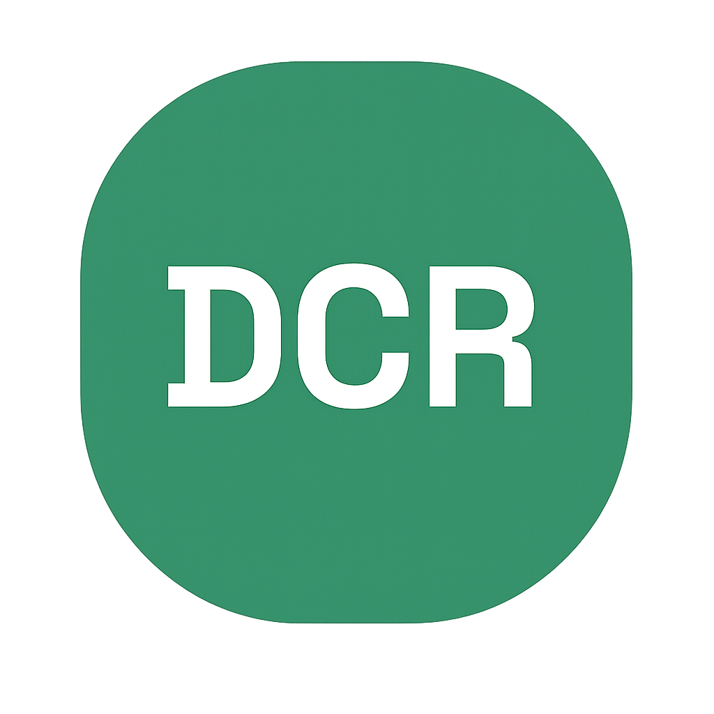

# Django Control Room skills

Build internal tools inside Django Admin by asking your coding agent for them.

> Build a tool for support to look up a customer and their recent orders.

> Add a billing operations page that lists failed payments with a retry button.

> Add a staff approval queue for refund requests over $500.

These skills turn requests like these into staff-only pages in your existing Django Admin, with permissions, tests, and a consistent UI, built on [Django Control Room](https://djangocontrolroom.com) (DCR). DCR calls each tool a **panel**. You do not need to know that word: the agent recognizes the request, checks your project, and installs DCR first if it is missing (after asking).

The skills are development-time guidance only. What they build depends on DCR's packages, not on this repository.

## Install

**Claude Code**

```
/plugin install dcr --marketplace django-control-room/skills
```

On versions older than 2.1.275: `/plugin marketplace add django-control-room/skills`, then `/plugin install dcr@django-control-room`.

**Codex**

```bash
codex plugin marketplace add django-control-room/skills
codex plugin add dcr@django-control-room
```

**Gemini CLI, Copilot, Cursor, and other agents**, with the [`skills` CLI](https://github.com/vercel-labs/skills):

```bash
npx skills add django-control-room/skills --skill '*'
```

Install all the skills: the others read shared docs from `dcr-reference`.

**By hand:** copy every folder in `skills/` side by side into `.claude/skills/` (Claude Code), `.cursor/skills/` (Cursor), or `.agents/skills/` (Codex, Gemini CLI, Copilot).

### Recommended: add the project rule

Agents load skills only when they judge a request relevant. A project rule is read every time, so "build a tool for X" reliably reaches DCR. Add [`project-rule/dcr.mdc`](project-rule/dcr.mdc) to Django projects that use DCR: as `.cursor/rules/dcr.mdc` in Cursor, or paste its body (without the frontmatter) into `CLAUDE.md` or `AGENTS.md`.

## Skills

| Skill | For |
|---|---|
| [`django-internal-tools`](skills/django-internal-tools/) | Start here. Recognizes requests for internal tools, support consoles, ops pages, approval workflows, and dashboards, reads the project, and hands off to the right skill below |
| [`dcr-setup`](skills/dcr-setup/) | Installing, configuring, or fixing DCR |
| [`dcr-create-internal-panel`](skills/dcr-create-internal-panel/) | A new tool for this project, as its own Django app |
| [`dcr-create-package-panel`](skills/dcr-create-package-panel/) | A reusable tool shipped as a Python package (PyPI or private index) |
| [`dcr-modify-panel`](skills/dcr-modify-panel/) | Extending or fixing a tool that already exists, without breaking its scopes, URLs, or settings |
| [`dcr-reference`](skills/dcr-reference/) | Shared DCR API docs the other skills read when needed. Not invoked directly |

If it is unclear whether a tool is for one project or many, the agent asks. Ordinary ModelAdmin changes, public-facing pages, and requests for another framework are left alone.

`dcr-create-package-panel` needs `cookiecutter>=2.0`.

## Development

- [`evals/triggers.md`](evals/triggers.md): does the right skill load for a given request? Each skill's `evals/` checks what it builds.
- Releasing: bump `version` in `plugin.json` and `.claude-plugin/plugin.json`, then run `python scripts/check_manifests.py` and `claude plugin validate . --strict --profile directory`, and tag.
